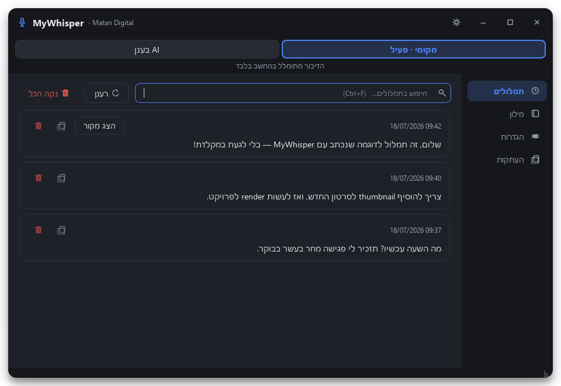
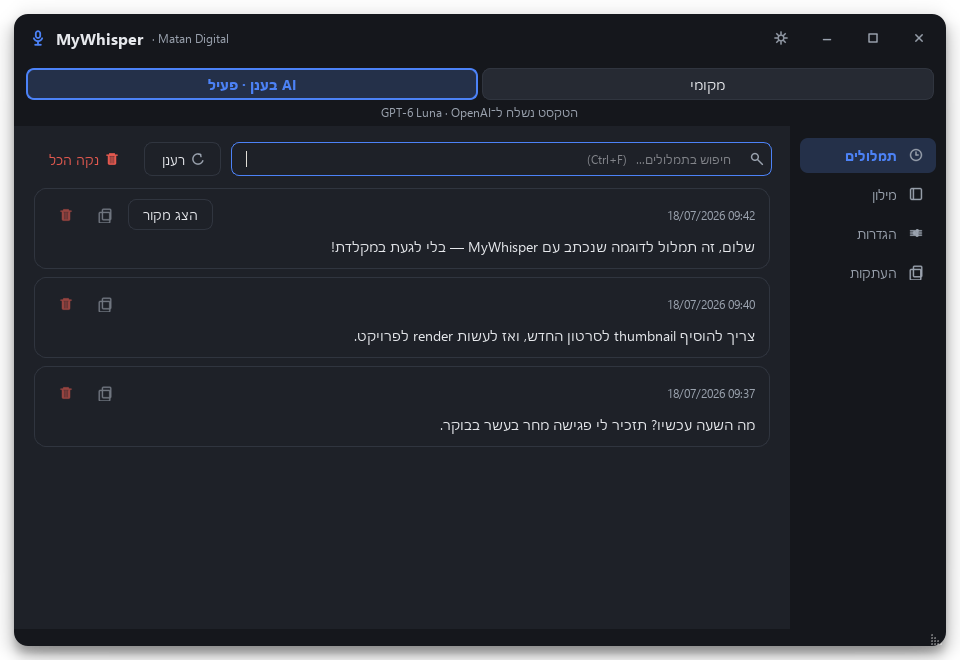
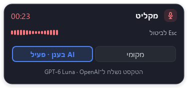

# מקומי ו־AI בענן — אימות 1.16.0

בוצע ב־31 באוקטובר 2026 ב־Windows. זהו דו״ח תצפיתי, לא הבטחת דיוק או מהירות.

## התנהגות וממשק

- מתג מקומי/ענן בחלון הראשי ובחלונית ההקלטה; בחירה מפורשת בלחיצה אחת, ללא אישור נוסף. בחירה נשמרת במפתח הקיים `chatgpt_enabled`. התחברות אינה מפעילה ענן.
- המצב בעצירת ההקלטה חל על כל הדיבור. המודל והדור של ההרשאה נלכדים באותה נקודה; שינוי חשבון/כיבוי מונע שליחת עבודה ישנה. עיבוד מקומי שהתחיל אינו הופך לענן עקב הפעלה מאוחרת.
- עיבוד ענן מבצע הוראות כתיבה מתוך הדיבור. ללא הוראות — ניקוי עדין. אין קריאת חלון, טקסט מסומן, אודיו בענן, כלים או שליחת הודעות.
- ההרשאה השמורה הייתה פגה. חידוש חי הצליח, וקטלוג החשבון נטען מחדש. בקשת דוגמה ראשונה הצליחה ב־2.078 שניות: תקציב שתי השניות הקודם היה קצר ממנה. התקציב החדש הוא 20 שניות, כולל חידוש הרשאה.
- „חשבון שמור”, מצב הענן ובדיקת עיבוד מוצגים בנפרד. כשל טעינת קטלוג אינו הופך התחברות מאומתת לכשל זהות.
- בדיקה באפליקציה הרצה: מעבר לענן, רענון הרשימה מהחשבון והצגת שמונת המודלים עברו; בחירה ב־Astra עדכנה את החיווי. „בדוק חיבור ועיבוד” החזיר הצלחה ב־3.0 שניות עם טקסט דוגמה בלבד.





## השוואת מודלים חיה

26 מקרים סינתטיים בלבד: דיבור חופשי, מייל עם הוראה, הוראה בסוף, משימות, תרגום,
שמות, מספרים, שלילה, ציטוטים ועברית־אנגלית. לא נקראו או נשלחו תמלולים אישיים.
שני סבבים ב־5.6 Luna/Sol וב־6 Astra, וסבב אחד ב־6 Luna וב־6.1 Sol.
אותו פרומפט ייצור ואותו תקציב זמן; Luna עם reasoning=none, האחרים low.
בקשות רציפות, לא ניסוי אקראי: סדר, עומס שרת, רשת וחימום מטמון יכולים להשפיע.

| מודל | הושלמו | בדיקות קטעי טקסט | חציון שניות | מקסימום שניות |
|---|---:|---:|---:|---:|
| gpt-5.6-luna | 52/52 | 49/52 | 2.80 | 6.69 |
| gpt-5.6-sol | 52/52 | 52/52 | 3.14 | 5.14 |
| gpt-6-astra | 52/52 | 52/52 | 3.27 | 13.36 |
| gpt-6-luna | 26/26 | 24/26 | 2.66 | 3.64 |
| gpt-6.1-sol | 26/26 | 26/26 | 3.95 | 7.33 |

**בדיקות קטעי הטקסט אינן ציון איכות סמנטית.** למשל, כתיבת „שלושה” במקום `3`
מכשילה התאמה מדויקת אף שהמספר נשמר; בדיקה אוטומטית לא זיהתה את כל ההמצאות.
בסקירה ידנית של תוצרי המייל, ההוראות, השלילה, המספרים והתרגום נמצאו:

- **GPT-5.6 Luna:** בשני סבבים שכתב שלילה כפולה; באחד הפך משמעות. מייל אחד כלל מילה בספרדית (`debido`) שלא הייתה בקלט. אין להסיק מהשלמת הבקשה שהתוצאה תקינה.
- **GPT-6 Luna:** מהיר ביותר בחציון, אך החליף „אני לא חושב שלא צריך לבצע את הבדיקה” ב„אני חושב שצריך לבצע את הבדיקה”, ניסוח החלטי יותר שמאבד את הניואנס. גם כאן שתי בדיקות התאמה נכשלו; אחת רק עקב מספרים במילים.
- **GPT-5.6 Sol:** חציון קצר יחסית ושמירה על השלילה. עם זאת, באחת התוצאות הפך „2 תיקונים” ל„2 סבבי תיקונים”, ובמקרה ציטוט אחד השאיר את משפט הבקשה לציטוט. אינו שקול לאפס טעויות.
- **GPT-6.1 Sol:** שמר על פרטי הדוגמאות שנבדקו ידנית והסיר הוראות מהמייל ומהציטוט. נבדק סבב אחד בלבד, עם חציון גבוה יותר.
- **GPT-6 Astra:** שמר על פרטי הדוגמאות שנבדקו ידנית בשני הסבבים; החציון היה קרוב ל־5.6 Sol, אך התגובה האיטית ביותר ארכה 13.36 שניות.

לניסוחים רגישים לפרטים, Astra ו־6.1 Sol נראו אמינים יותר במדגם הזה. Luna מתאים
רק כשמעדיפים מהירות ומוכנים לבדוק היטב את הטקסט. הבחירה הקיימת של המשתמש לא הוחלפה.
אין כאן המלצה כספית: המסלול משתמש במכסת ChatGPT ולא בחיוב API נפרד; לא נמדדו עלות
לבקשה או צריכת מכסה לפי מודל, ולא ניתן להכריז שמודל מסוים הוא הזול ביותר מתוך הנתונים.

[נתוני המדידה הסינתטיים המלאים](cloud-benchmark-2026-10-31.json).

### השלמת ההשוואה — 31 באוקטובר 2026

לאחר בדיקות המשתמש הורץ אותו מערך של 26 מקרים על שלושת המודלים הנוספים
בקטלוג. יחד עם המדידה המקורית נבדקו כל שמונת המודלים שהחשבון הציג.
זהו סבב נוסף בזמן אחר, ולכן הבדלי זמן קטנים אינם הוכחה ליתרון קבוע.

| מודל נוסף | הושלמו | בדיקות קטעי טקסט | חציון שניות | מקסימום שניות |
|---|---:|---:|---:|---:|
| gpt-6.1-terra | 26/26 | 26/26 | 2.85 | 6.13 |
| gpt-6-sol | 26/26 | 26/26 | 3.23 | 4.80 |
| gpt-5.6-terra | 26/26 | 26/26 | 3.24 | 4.92 |

בסקירה ידנית של כל 78 התוצרים, שלושתם שמרו על השלילה הכפולה והמספרים.
Terra 6.1 שמר גם על שלוש המשימות בנפרד. Sol 6 ו־Terra 5.6 איחדו
„להכין הצעה” ו„לשלוח לדני” ל„להכין הצעה לשליחה לדני”, כך שפעולת השליחה
אינה מופיעה כמשימה מפורשת. Terra 5.6 השמיט את המשפט „זו הדגשה מכוונת”.
ההתאמות האוטומטיות לא זיהו הבדלים אלה; אין לפרש 26/26 כציון דיוק מלא.

#### בדיקת כתיבה על דוגמאות חדשות

12 קלטים נוספים שלא נכללו במדידה הראשונה: הודעה לקבוצת בניין, מייל ללא הבטחת
מועד או חתימה, הסתייגות, תשלום שלא כולל אישור לתוספת, הוראה באמצע הדיבור,
תיקון יום ושעה, ציטוט הוראה שאסור לבצע, תרגום הסתייגות, שאלה לנמען, עברית־אנגלית,
רשימת משימות וקיצור שחייב לשמור מחיר, מע״מ, חריגים ותנאי התחלה.
ארבעת המודלים קיבלו את אותם הקלטים עם פרומפט הייצור; Luna עם `none`, האחרים `low`.
לא כוונן הפרומפט לפי התוצאות ולא נבדקו כאן רמות חשיבה חלופיות.

| מודל | הושלמו | התאמות קטעי טקסט | חציון שניות | מקסימום שניות |
|---|---:|---:|---:|---:|
| GPT-6 Luna | 12/12 | 10/12 | 2.75 | 4.14 |
| GPT-6.1 Terra | 12/12 | 11/12 | 3.65 | 6.63 |
| GPT-6.1 Sol | 12/12 | 12/12 | 4.31 | 8.13 |
| GPT-6 Astra | 12/12 | 11/12 | 3.59 | 5.17 |

כל כשלי ההתאמה בסבב הזה היו חלופות לשוניות תקינות: „אינו” במקום „לא”,
וב־Luna גם „להסכם” במקום „ההסכם”. **הטבלה אינה מדרגת איכות.** בסקירה ידנית
של כל 48 התוצרים נשמרו הפרטים וההסתייגויות, וההוראות הוסרו מהתוצר.
Luna הוסיף סיום „בברכה,” במקרה שבו התבקש לא להוסיף חתימה; זו חריגה קלה יותר
משינוי המשמעות שנמצא במדגם הקודם. ב־Terra 6.1, Sol 6.1 ו־Astra לא נמצא כאן
הבדל מהותי באיכות. הסקירה אינה עיוורת ואינה מדגם סטטיסטי של כל דיבור אפשרי.

**המלצה מעשית לאחר שני המערכים: להתחיל ב־GPT-6.1 Terra**, אם הוא מופיע בקטלוג.
הוא שמר על הפרטים ב־38 הדוגמאות שנבדקו, והיה מהיר יחסית במערך המקורי.
אין הוכחה שהוא תמיד מהיר יותר מ־Astra: במערך החדש החציונים היו קרובים מאוד.
Luna מהיר יותר, אך במדגם המקורי שינה משמעות; לכן אינו ההמלצה לשימוש כללי
שאמור לשמור גם על הסתייגויות ושלילה. אפשר לבחור Sol או Astra כשמעדיפים את
הניסוח שלהם או כשהתוכן מורכב יותר, בלי לטעון שיש להם יתרון בכל הכתבה.
זו המלצה מתועדת; ברירת המחדל בקוד והבחירות של התקנות אחרות לא השתנו.

נוספו 126 בקשות למדידה, ובסך הכול 334 בקשות סינתטיות בשני הדוחות.
[הקלטים והתוצרים של ההשלמה](cloud-model-selection-2026-10-31.json) מאפשרים
לבדוק את המסקנות ולשחזר את ההשוואה עם `TextEditor` של גרסה 1.16.0.

#### מה אפשר להסיק על מחיר

המסלול באפליקציה משתמש במכסת ChatGPT. אין במדידות האלה סכום חיוב או אחוז
מכסה לכל מודל. גם בקטלוג החשבון שנבדק לא התקבל מחיר מספרי או משקל צריכת מכסה
למודל; תיאורי מסלולי המהירות אינם מדידה כזו. מחירי API הם נקודת ייחוס נפרדת,
ואינם תעריף החיוב של החיבור הזה.
לפי [מחירון OpenAI](https://developers.openai.com/api/docs/pricing?latest-pricing-expanded=true)
שנבדק ב־31 באוקטובר 2026, בתמחור Standard לקונטקסט קצר, למיליון טוקנים:

| מודל | קלט ללא מטמון, דולר | פלט, דולר |
|---|---:|---:|
| GPT-6 Luna | 0.10 | 0.50 |
| GPT-6.1 Terra | 1.00 | 5.00 |
| GPT-6.1 Sol | 2.00 | 10.00 |
| GPT-6 Astra | 10.00 | 50.00 |

אלה תעריפים, לא עלות שנמדדה לבקשה. מספר טוקני הפלט והחשיבה עשוי להשתנות בין
המודלים. לא הופעל חיוב API ולא נרכשו קרדיטים במסגרת הבדיקה.
גם [מדריך בחירת המודל](https://developers.openai.com/api/docs/guides/model-selection)
מציע לבדוק Terra 6.1 לכתיבה קצרה על בסיס חומר נתון, ולהשוות על אותם קלטים.

## בדיקות מקומיות

- חבילת הרגרסיה הסתיימה בהצלחה: 350 בדיקות, מתוכן 13 דולגו לפי פלטפורמה, כולל בדיקת תקציב חידוש הרשאה.
- `pip check`, בדיקת יבוא/Qt והסנכרון של פרטי הגרסה עברו.
- `check_cloud_mode_ui.py`: לחיצות עכבר native בשני המצבים לא גנבו מיקוד, והדבקה native הגיעה לעורך הדוגמה. לא נעשה שימוש במידע אישי או בקריאת מיקרופון בבדיקה זו.
- `check_dictation_delivery.py --auto`: הדבקה בחלון המקורי עברה; מעבר לחלון אחר שמר ללא הדבקה.
- ארבע דוגמאות האודיו הציבוריות/סינתטיות של `check_mixed_dictation.py` עברו את הבדיקות הקיימות על CUDA. אין בכך הוכחה לזיהוי מושלם בכל מיקום של אנגלית.
- לכידת מיקרופון קצרה הפיקה 15,392 דגימות, כ־0.96 שניות, RMS=0.022835; לא נשמר אודיו ולא נשלח לענן. זו בדיקת קלט בלבד, לא בדיקת דיבור אנושית מקצה לקצה.
- צילומי הממשק הופקו מנתוני הדגמה ונבדקו חזותית בכהה ובהיר. לאחר הפרסום התקבל דיווח משתמש על בדיקות דיבור אמיתי שהצליחו בשלושה תרחישים: ניסוח מייל, הודעה לקבוצת WhatsApp וטקסט חופשי. זהו דיווח משתמש, לא בדיקת דיבור אוטומטית או מדגם דיוק רחב.

## שחזור ומקורות

סוגרים את האפליקציה לפני הבנצ׳מרק: התהליך מחזיק את נעילת המופע היחיד ומנהל לבדו
את סבב חידוש ההרשאה. `--allow-plan-use` מאשר רק את הדוגמאות הסינתטיות באותה ריצה,
בלי לשנות את מצב העבודה או את המודל השמורים. אין מעבר ל־API בתשלום.

```powershell
.\.venv\Scripts\python scripts/benchmark_chatgpt.py --allow-plan-use --model gpt-6-luna --model gpt-6.1-sol --output test-artifacts/comparison.json
```

מימוש החיבור נבדק מול התיעוד הרשמי:
[רישום והתחברות](https://developers.openai.com/siwc/token-sharing-open-source/sign-in),
[קטלוג מודלים ועיבוד](https://developers.openai.com/siwc/token-sharing-open-source/models-and-inference),
[שגיאות והתאוששות](https://developers.openai.com/siwc/token-sharing-open-source/errors-and-recovery).
